<!-- Hero: animated terminal banner (twinkling stars, shield emblem, rotating typing lines) -->
<picture>
  <source media="(prefers-color-scheme: dark)" srcset="./assets/hero-dark.svg">
  
</picture>

<!-- Role badges -->
<picture>
  <source media="(prefers-color-scheme: dark)" srcset="https://img.shields.io/badge/Developer-161B22?style=for-the-badge&logo=codeforces&logoColor=00FF9C">
  
</picture>
<picture>
  <source media="(prefers-color-scheme: dark)" srcset="https://img.shields.io/badge/Cybersecurity_Learner-161B22?style=for-the-badge&logo=hackthebox&logoColor=00FF9C">
  
</picture>
<picture>
  <source media="(prefers-color-scheme: dark)" srcset="https://img.shields.io/badge/Linux_Enthusiast-161B22?style=for-the-badge&logo=linux&logoColor=00FF9C">
  
</picture>

 

<picture>
  <source media="(prefers-color-scheme: dark)" srcset="./assets/section-about-dark.svg">
  
</picture>

<table>
  <tr>
    <td width="50%" valign="top">
      <b>🎓 Education</b>  
      👾 <b>Master of Science in Cybersecurity</b> (M.Sc. Cybersecurity)  
      🎓 <b>Bachelor of Computer Applications</b> (BCA)
    </td>
    <td width="50%" valign="top">
      <b>🔐 Certification</b>  
      Preparing for the <b>Certified Ethical Hacker (CEH)</b> certification
    </td>
  </tr>
  <tr>
    <td width="50%" valign="top">
      <b>📚 Learning</b>  
      🐍 Learning <b>Python Programming</b>  
      🌐 Exploring <b>Web Development</b>
    </td>
    <td width="50%" valign="top">
      <b>🐧 Daily Driver</b>  
      Daily driving <b>Linux</b> (Arch &amp; Kali)
    </td>
  </tr>
  <tr>
    <td colspan="2" valign="top">
      <b>🎯 Goal &amp; Mission</b>  
      🎯 Planning to become a skilled <b>developer &amp; security expert</b>  
      🚀 Mission: Become a <b>Skilled Developer &amp; Security Expert</b>
    </td>
  </tr>
</table>

 

<picture>
  <source media="(prefers-color-scheme: dark)" srcset="./assets/section-skills-dark.svg">
  
</picture>

<table width="100%">
  <tr>
    <td width="34%" valign="middle">
      <b>🌐 Languages</b> 
      Python · HTML · CSS · JS · Bash
    </td>
    <td width="66%" valign="middle">
      <picture><source media="(prefers-color-scheme: dark)" srcset="https://skillicons.dev/icons?i=python&theme=dark"></picture>&nbsp;&nbsp;<picture><source media="(prefers-color-scheme: dark)" srcset="https://skillicons.dev/icons?i=html&theme=dark"></picture>&nbsp;&nbsp;<picture><source media="(prefers-color-scheme: dark)" srcset="https://skillicons.dev/icons?i=css&theme=dark"></picture>&nbsp;&nbsp;<picture><source media="(prefers-color-scheme: dark)" srcset="https://skillicons.dev/icons?i=js&theme=dark"></picture>&nbsp;&nbsp;<picture><source media="(prefers-color-scheme: dark)" srcset="https://skillicons.dev/icons?i=bash&theme=dark"></picture>
    </td>
  </tr>
  <tr>
    <td width="34%" valign="middle">
      <b>🛠️ Tools &amp; OS</b> 
      Linux · Arch · Kali · Git · GitHub · VS Code
    </td>
    <td width="66%" valign="middle">
      <picture><source media="(prefers-color-scheme: dark)" srcset="https://skillicons.dev/icons?i=linux&theme=dark"></picture>&nbsp;&nbsp;<picture><source media="(prefers-color-scheme: dark)" srcset="https://skillicons.dev/icons?i=arch&theme=dark"></picture>&nbsp;&nbsp;<picture><source media="(prefers-color-scheme: dark)" srcset="https://skillicons.dev/icons?i=kali&theme=dark"></picture>&nbsp;&nbsp;<picture><source media="(prefers-color-scheme: dark)" srcset="https://skillicons.dev/icons?i=git&theme=dark"></picture>&nbsp;&nbsp;<picture><source media="(prefers-color-scheme: dark)" srcset="https://skillicons.dev/icons?i=github&theme=dark"></picture>&nbsp;&nbsp;<picture><source media="(prefers-color-scheme: dark)" srcset="https://skillicons.dev/icons?i=vscode&theme=dark"></picture>
    </td>
  </tr>
</table>

 

<picture>
  <source media="(prefers-color-scheme: dark)" srcset="./assets/section-stats-dark.svg">
  
</picture>

<picture>
  <source media="(prefers-color-scheme: dark)" srcset="https://streak-stats.demolab.com/?user=rajrathod07&background=0D1117&border=30363D&stroke=30363D&ring=00FF9C&fire=00FF9C&currStreakNum=FFFFFF&currStreakLabel=00FF9C&sideNums=FFFFFF&sideLabels=8B949E&dates=8B949E&border_radius=6">
  
</picture>

  

<picture>
  <source media="(prefers-color-scheme: dark)" srcset="https://github-readme-stats.vercel.app/api?username=rajrathod07&show_icons=true&bg_color=0D1117&title_color=00FF9C&icon_color=00FF9C&text_color=C9D1D9&border_color=30363D&border_radius=6">
  
</picture>

  

<!-- Profile views -->

 

<picture>
  <source media="(prefers-color-scheme: dark)" srcset="./assets/section-connect-dark.svg">
  
</picture>

  <a href="mailto:devloper.raj07@gmail.com">
    <picture>
      <source media="(prefers-color-scheme: dark)" srcset="https://img.shields.io/badge/EMAIL-161B22?style=for-the-badge&logo=gmail&logoColor=00FF9C">
      
    </picture>
  </a>
  <a href="https://www.linkedin.com/in/rajrathod07">
    <picture>
      <source media="(prefers-color-scheme: dark)" srcset="https://img.shields.io/badge/LINKEDIN-161B22?style=for-the-badge&logo=linkedin&logoColor=00FF9C">
      
    </picture>
  </a>
  <a href="https://portfolio-raj-rathod.vercel.app/">
    <picture>
      <source media="(prefers-color-scheme: dark)" srcset="https://img.shields.io/badge/PORTFOLIO-161B22?style=for-the-badge&logo=googlechrome&logoColor=00FF9C">
      
    </picture>
  </a>

 

<h3 align="center">⚡ Keep Learning. Keep Building. Keep Hacking. ⚡</h3>

<picture>
  <source media="(prefers-color-scheme: dark)" srcset="./assets/footer-dark.svg">
  
</picture>
